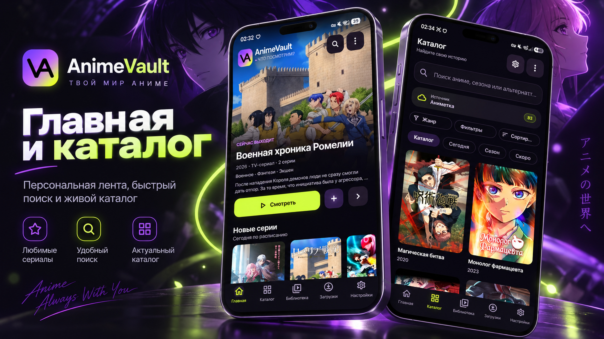
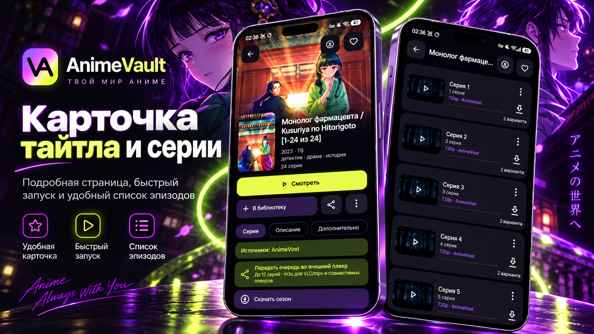
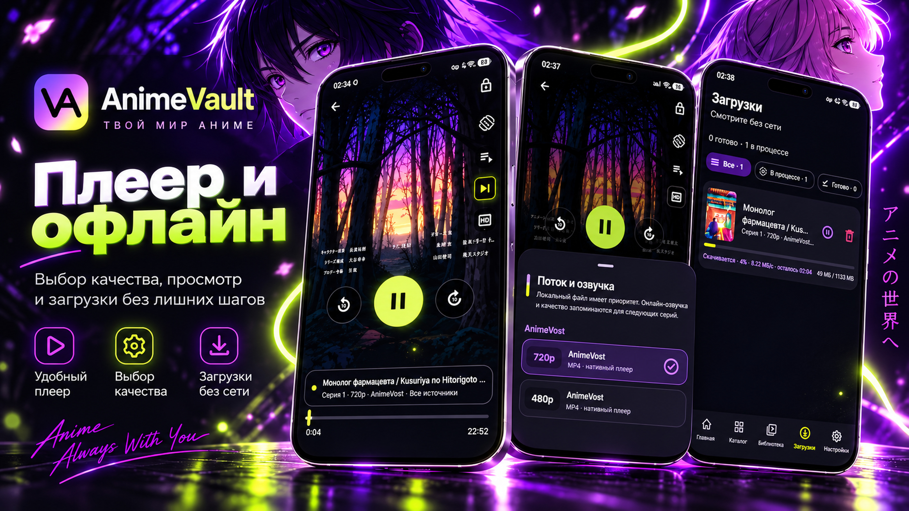
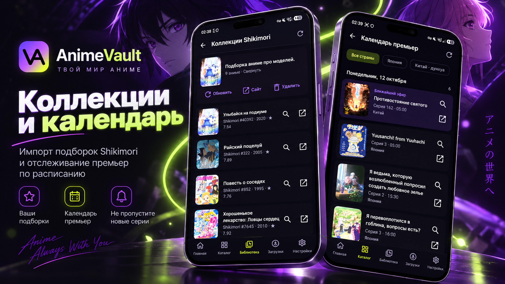

<div align="center">


<h1>AnimeVault</h1>

<p><strong>Ваша коллекция. Ваш ритм.</strong><br>
Аниме онлайн и офлайн в одном Android-приложении.</p>

<p>
  
  
  
  <br>
  
  
  <a href="https://github.com/Aqua666-prog/AnimeVault/actions/workflows/build-apk.yml"></a>
</p>

<p>
  <a href="https://github.com/Aqua666-prog/AnimeVault/actions/workflows/build-apk.yml"><strong>Скачать APK</strong></a>
  &nbsp; · &nbsp;
  <a href="https://github.com/Aqua666-prog/AnimeVault/tree/main"><strong>Исходный код</strong></a>
  &nbsp; · &nbsp;
  <a href="CHANGELOG.md"><strong>История версий</strong></a>
</p>

<p><sub>3.0.10 · versionCode 70 · APK для тестирования доступен в GitHub Actions</sub></p>

</div>

---

<p align="center">
  <a href="#возможности">Возможности</a> ·
  <a href="#что-нового-в-3010">Новое в 3.0.10</a> ·
  <a href="#скриншоты">Скриншоты</a> ·
  <a href="#источники">Источники</a> ·
  <a href="#установка">Установка</a> ·
  <a href="#сборка-из-исходников">Сборка</a>
</p>

## Об AnimeVault

AnimeVault объединяет онлайн-каталог аниме, просмотр, офлайн-загрузки и локальную медиатеку. Можно найти тайтл у подключённых источников, сохранить серии на устройство и продолжить просмотр с прежнего места. История, прогресс и личные списки остаются под рукой.

Проект развивается прежде всего для персонального использования. AniList, Shikimori и другие внешние каталоги дополняют библиотеку названиями, постерами и сведениями об аниме; возможности просмотра зависят от выбранного видеопровайдера.

## Возможности

### Онлайн-просмотр

- Каталог и поиск по подключённым источникам, фильтры и история запросов. Режим **«Все источники»** объединяет результаты нескольких адаптеров.
- Выбор озвучки и качества из вариантов, которые предоставляет источник. Прямые MP4/HLS-потоки воспроизводятся через Media3; для некоторых встроенных плееров предусмотрен WebView.

### Плеер

- Media3 / ExoPlayer для онлайн-видео и локальных файлов: перемотка, скорость, масштаб, выбор дорожек и субтитры.
- Сохранение позиции, продолжение просмотра и переход к следующей серии. Полный экран, блокировка управления и Picture-in-Picture на поддерживаемых устройствах с Android 8.0+.
- Настройки для отдельных тайтлов, таймер сна, эквалайзер и пропуск заставок при наличии таймкодов у источника.

### Офлайн-загрузки

- Загрузка отдельных серий и последовательная очередь сезона. Пауза, продолжение, повторная попытка, удаление, прогресс, скорость и оценка оставшегося времени.
- Нативная загрузка MP4 и HLS через WorkManager. Поддерживаются HLS master-плейлисты, сегменты TS/fMP4, init-сегменты и AES-128; встроенные веб-плееры сами по себе не дают скачиваемый файл.
- Повторные запросы с увеличением интервала, обновление истёкших ссылок и перебор альтернативных потоков. Докачка MP4 зависит от поддержки HTTP Range сервером; HLS использует сохранённые сегменты и журнал загрузки.

Готовые файлы проверяются и добавляются в локальную библиотеку. Доступность скачивания зависит от провайдера — ограничения перечислены [ниже](#источники).

### Интеграции

- **AniList:** метаданные, связи между сезонами и синхронизация прогресса после настройки собственного OAuth Client ID и входа в приложении.
- **Shikimori:** просмотр публичных коллекций, импорт по ссылке, русские названия, постеры, годы и рейтинги. Из карточки можно перейти к поиску в онлайн-каталоге AnimeVault.
- **Календарь премьер:** расписание AniList по дням, фильтры стран и русские названия из Shikimori, если перевод найден.
- **Tenrai и AnimeThemes:** дополнительные сведения о тайтлах и лента опенингов/эндингов. Наполнение зависит от внешнего сервиса и конкретного аниме.

### Личная медиатека

- Видео из выбранных папок через Storage Access Framework, рекурсивное сканирование и распознавание сезонов и серий по именам файлов. MediaStore может дополнять сведения о локальном видео.
- Ручное объединение и разделение тайтлов, обложки, связь с онлайн-релизом, избранное и пользовательские списки.
- Общая история локального и онлайн-просмотра, прогресс, статистика и резервное копирование данных приложения.

### Интерфейс

- Jetpack Compose и Material 3: постеры, обложки, нижняя навигация на телефонах и боковая панель в широких окнах.
- Фирменная тема **Vault Lemon Purple**, Midnight, AMOLED и Dynamic. Системные динамические цвета доступны с Android 12; на более старых версиях используется палитра Vault.
- Настройка акцента, анимаций, оформления библиотеки и параметров плеера.

## Что нового в 3.0.10

- Исправлен поиск черновика при автоматической публикации APK и JSON в GitHub Releases.
- Сохранён глобальный выбор языка названий из 3.0.9.
- [Результаты диагностики и проверки](RELEASE_3.0.10.md).

## Что нового в 3.0.9

- Глобальная настройка языка названий: русский (по умолчанию), международный, японский.
- Названия обновляются без перезапуска; сохранены исходные значения, ID и поиск по альтернативным названиям.
- [Описание реализации, fallback и ограничения проверки](RELEASE_3.0.9.md).

## Что нового в 3.0.8

- Переработан вход: раскрытие единого логотипа мягкими створками, световые орбиты, частицы и плавная остановка композиции.
- Устранена смена двух разных портретов. Вход длится 2,1 секунды и сохраняет поддержку уменьшения анимации.
- Версия **3.0.8 (68)**. [Описание выпуска и проверки](RELEASE_3.0.8.md).

## Что нового в 3.0.7

- Новая айдентика Макимы: иконки, логотипы и оформление запуска из утверждённого комплекта.
- Анимированный вход длительностью около 1,75 секунды с пропуском при уменьшении анимации.
- Версия приложения — **3.0.7 (67)**. Метаданные обновления формируются из собранного APK и проверяются на соответствие тегу релиза.

Подготовка выпуска и ограничения проверок: [RELEASE_3.0.7.md](RELEASE_3.0.7.md).

## Что нового в 3.0.3

Главное изменение — переработанный **календарь премьер**:

- Русские названия загружаются из Shikimori по связанному MAL ID. Если перевод или сервис недоступен, остаётся название AniList.
- Фильтры **«Все / Япония / Китай»**, группировка по дням, переход между неделями и время эфира в часовом поясе устройства.
- Нажатие на тайтл открывает поиск внутри AnimeVault; для него используется русское название либо исходное название, пригодное для поиска у провайдеров.
- Если AniList не передал ни одного пригодного названия, карточка получает понятную подпись вместо исчезновения из расписания.

Сам календарь и первоначальный импорт коллекций появились в **3.0.1**. Обновлённый каталог коллекций Shikimori, их обогащение метаданными и отдельное исправление строк `null` в названиях AniList относятся к **3.0.2**. В 3.0.3 эти изменения сохранены и доработана обработка расписания.

Подробности и прежние описания релизов — в [CHANGELOG.md](CHANGELOG.md).

## AnimeVault в действии

<p align="center">
  
</p>

<p align="center">
  
</p>

<p align="center">
  
</p>

<p align="center">
  
</p>

## Источники

В приложение подключены **12 прямых адаптеров** и объединяющий режим **«Все источники»**. Таблицы описывают реализацию в исходниках; они не подтверждают доступность сайтов или каждого потока в данный момент.

### Основные адаптеры

Эти три адаптера не помечены экспериментальными в коде.

| Источник | Каталог и поиск | Видео и ограничения |
| :--- | :--- | :--- |
| **AniLiberty** | Каталог, текстовый поиск | HLS-потоки релизов |
| **AnimeVost** | Каталог, текстовый поиск | Прямые MP4-потоки |
| **Animetka** | Каталог, текстовый поиск | HLS/MP4, переводы и субтитры; **скачивание отключено** флагом адаптера |

### Экспериментальные интеграции

Эти адаптеры, как и режим «Все источники», имеют флаг `isExperimental`. Возможны ошибки поиска, получения серий или разрешения потока независимо друг от друга.

| Источник | Каталог и поиск | Особенности |
| :--- | :--- | :--- |
| **Kodik** | Каталог, текстовый поиск | Озвучки, субтитры; прямой HLS или встроенный плеер. Доступ к API зависит от авторизации |
| **AnimeLib** | Каталог, текстовый поиск | Встроенный плеер; прямые потоки при наличии подходящего токена |
| **Dream Cast** | Каталог, текстовый поиск | Прямые HLS-потоки |
| **AniMedia** | Каталог, текстовый поиск | HLS; поиск ограничен одной страницей результатов |
| **AnimeON** | Текстовый поиск | Общий каталог отключён; потоки из API |
| **SameBand** | Новинки, поиск от 4 символов | Прямые HLS-потоки |
| **AnimeBest** | Текстовый поиск | Общий каталог отключён; разрешение встроенного плеера в HLS |
| **Jut.su** | Ссылка или slug тайтла | Общего каталога и текстового поиска нет; извлечение MP4 со страницы |
| **YummyAnime / Yani** | Каталог, текстовый поиск | Требуется собственный ключ `X-Application`; Kodik или встроенный плеер |

Источники можно включать и отключать в настройках. AniList, Shikimori и Tenrai используются для сведений об аниме и связанных интеграций; наличие карточки в их каталогах не означает наличия видео.

## Автоматический выпуск

После слияния PR с новой версией в `main` GitHub Actions сам создаёт тег и GitHub Release,
прикладывает проверенный APK и `animevault-update.json`, формирует описание по объединённым PR.
Публикация выполняется после успешных сборки, тестов, lint и onboarding-проверок.
Ручное создание релиза и загрузка файлов больше не нужны.

[Правила выпуска и повторного запуска](docs/AUTOMATIC_RELEASES.md).

## Установка

**[Перейти к APK в GitHub Actions](https://github.com/Aqua666-prog/AnimeVault/actions/workflows/build-apk.yml)** · [Все запуски Actions](https://github.com/Aqua666-prog/AnimeVault/actions)

1. Откройте workflow **Build AnimeVault APK** и выберите последнюю успешную сборку ветки **`main`** с зелёной отметкой.
2. Внизу страницы запуска найдите **Artifacts** → **`AnimeVault-debug-<SHA коммита>`**. Для скачивания артефакта нужно войти в GitHub.
3. Скачайте ZIP, распакуйте **`AnimeVault.apk`** и установите его на устройство с **Android 7.0+**. При необходимости разрешите установку APK для приложения, которым открываете файл.

Артефакты этого workflow хранятся **14 дней**. Если файл уже удалён, проверьте более свежие успешные запуски. При переходе на другую версию сверяйте название артефакта и версию приложения.

**Это debug APK для тестирования.** Он подписан отладочным ключом. На момент подготовки README подписанная release-сборка в GitHub Releases не опубликована. Обновление поверх установленного приложения требует совместимой подписи; детали — в [документации о подписи](docs/SIGNING.md).

## Технологический стек

| Основа | Использование |
| :--- | :--- |
| **Kotlin · Coroutines · Flow** | Логика приложения, асинхронные операции и состояние экранов |
| **Jetpack Compose · Material 3** | Интерфейс, темы и навигация |
| **Android Media3 / ExoPlayer** | Локальное видео, HLS/MP4, дорожки и субтитры |
| **Room · KSP** | Библиотека, прогресс, онлайн-состояние и записи загрузок |
| **WorkManager** | Загрузки и фоновое пересканирование |
| **OkHttp · Retrofit · Gson · Okio** | HTTP, API, JSON и работа с данными |
| **Coil 3** | Загрузка и отображение постеров |
| **SAF · DocumentFile · MediaStore** | Доступ к выбранным папкам и локальному видео |
| **Android Keystore** | Защищённое хранение пользовательских токенов и сессий |

## Сборка из исходников

Нужны **JDK 17**, Android SDK с платформой **API 37** и установленными SDK Build Tools. Gradle **9.5.0** запускается через Wrapper из репозитория; устанавливать отдельный Gradle не требуется.

Укажите JDK 17 в `JAVA_HOME`, а каталог SDK — в `ANDROID_HOME` либо в локальном `local.properties` через `sdk.dir`. Android Studio может настроить путь к SDK при открытии проекта.

```bash
git clone https://github.com/Aqua666-prog/AnimeVault.git
cd AnimeVault
git switch main
chmod +x gradlew

# Unit-тесты
./gradlew --no-daemon testDebugUnitTest

# Android lint
./gradlew --no-daemon lintDebug

# Debug APK
./gradlew --no-daemon assembleDebug
```

Результат: `app/build/outputs/apk/debug/app-debug.apk`.

`KODIK_API_TOKEN` — необязательная переменная окружения сборки для собственного доступа к Kodik API. Без неё проект собирается, но работа интеграции зависит от доступных способов авторизации. OAuth Client ID AniList и ключ YummyAnime настраиваются в приложении. Значения токенов, файлы ключей подписи и приватные конфигурации нельзя добавлять в Git.

Для собственной release-сборки параметры подписи `ANIMEVAULT_RELEASE_KEYSTORE`, `ANIMEVAULT_RELEASE_STORE_PASSWORD`, `ANIMEVAULT_RELEASE_KEY_ALIAS` и `ANIMEVAULT_RELEASE_KEY_PASSWORD` задаются локально в окружении сборки. Без ключа `assembleRelease` не создаёт подписанный APK.

---

## Ограничения

Доступность внешних источников зависит от региона, авторизации, состояния API и изменений сайтов. AnimeVault не гарантирует доступность конкретного аниме, озвучки, качества или скачивания.

Приложение обращается к внешним сервисам. Права на видео, постеры и другие материалы принадлежат соответствующим правообладателям. AnimeVault — самостоятельный проект без официальной связи с AniList или Shikimori. Сведения об интеграциях собраны в [NOTICE.md](NOTICE.md).
