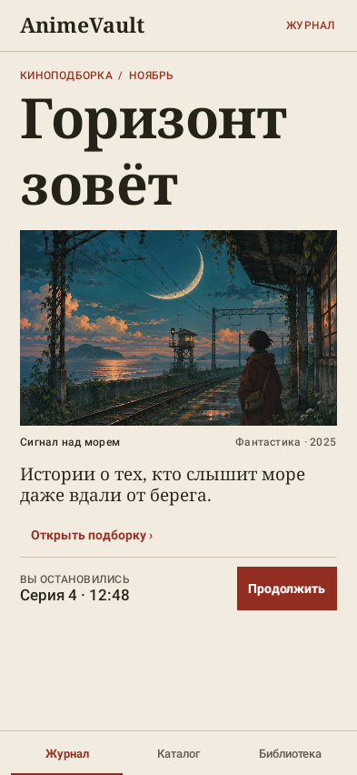
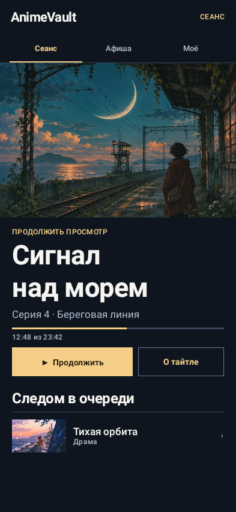
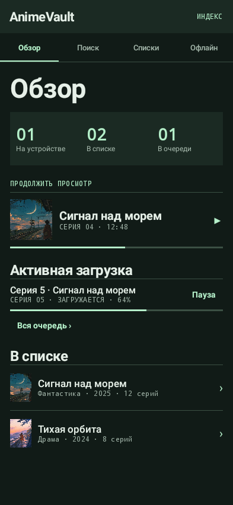

# AnimeVault 5.0 · сравнение концепций

| Журнал | Сеанс | Индекс |
|---|---|---|
|  |  |  |
| **Выбрать.** Тематический выпуск, обложка, каталог-указатель | **Продолжить.** Один незаконченный сеанс и короткий путь к просмотру | **Управлять.** Счётчики, результаты, очереди и быстрый вход в офлайн |
| [Дизайн-контракт](journal/DESIGN.md) | [Дизайн-контракт](session/DESIGN.md) | [Дизайн-контракт](index/DESIGN.md) |

«Сеанс» ставит выше всего возврат к эпизоду. «Журнал» даёт самый выраженный редакционный голос. «Индекс» выигрывает, когда главная работа пользователя — поиск и управление коллекцией. Выбор зависит от того, какую задачу должна выполнять главная при каждом запуске.

## Галерея Roborazzi

Все PNG отрисованы из Compose в Robolectric Native Graphics, API 35, mdpi. Компактный портрет — 393×852 dp, плеер в альбомной ориентации — 852×393 dp, каталог для крупного текста — 320×720 dp с font scale 1.6. Масштаб шрифта задан через Compose LocalDensity. Захвачена область приложения. Тайтлы и кадры вымышлены. Статусы загрузки и плеера задаёт тестовая модель. Иллюстрации сгенерированы для этих фикстур и хранятся в debug-ресурсах. [Тесты](../../../app/src/visualTest/debug/java/com/sergey/animevault/discovery/DiscoveryScreenshotTest.kt).

| Экран | Журнал | Сеанс | Индекс |
|---|---|---|---|
| Главная | [PNG](journal/screenshots/home.png) | [PNG](session/screenshots/home.png) | [PNG](index/screenshots/home.png) |
| Каталог | [PNG](journal/screenshots/catalog.png) | [PNG](session/screenshots/catalog.png) | [PNG](index/screenshots/catalog.png) |
| Страница аниме | [PNG](journal/screenshots/title.png) | [PNG](session/screenshots/title.png) | [PNG](index/screenshots/title.png) |
| Библиотека | [PNG](journal/screenshots/library.png) | [PNG](session/screenshots/library.png) | [PNG](index/screenshots/library.png) |
| Загрузки | [PNG](journal/screenshots/downloads.png) | [PNG](session/screenshots/downloads.png) | [PNG](index/screenshots/downloads.png) |
| Плеер | [PNG](journal/screenshots/player.png) | [PNG](session/screenshots/player.png) | [PNG](index/screenshots/player.png) |
| Плеер, landscape | [PNG](journal/screenshots/player-landscape.png) | [PNG](session/screenshots/player-landscape.png) | [PNG](index/screenshots/player-landscape.png) |
| Каталог, шрифт 1.6× | [PNG](journal/screenshots/catalog-large-text.png) | [PNG](session/screenshots/catalog-large-text.png) | [PNG](index/screenshots/catalog-large-text.png) |

В Android Studio доступны три интерактивных Preview в [DiscoveryPrototype.kt](../../../app/src/debug/java/com/sergey/animevault/discovery/DiscoveryPrototype.kt). Включите Interactive Mode, чтобы пройти навигацию, проверить поиск/жанры, сохранить тайтл, поставить загрузку на паузу и открыть управление плеером. «Воспроизведение» изменяет состояние элементов управления и позиции на тестовом кадре.

## Ревью концепций

Экспертная оценка по адаптированным рубрикам impeccable и gstack. Десятка означает подтверждение задачи на рабочем контенте, Android-устройстве и у представителей целевой аудитории. Оценки опираются на реализованные экраны, данные о продукте и описанные предположения. [Методики и версии](DESIGN_SKILLS.md).

| Критерий | Журнал | Сеанс | Индекс | Что нужно для 10 |
|---|---|---|---|---|
| Информационная архитектура | **7**. Ясная роль выпуска. Офлайн глубже | **8**. Каждая вкладка соответствует намерению. «Моё» требует проверки названия | **9**. Офлайн на первом уровне. Поиск и списки различимы | Пользователь находит каждое вторичное назначение без подсказки |
| Состояния взаимодействия | **7**. Поиск, пауза и Back. Первый выпуск требует данных | **7**. Продолжение отработано, без истории композиция не доказана | **8**. Видны очередь и файлы, критичен recoverable error | Работают состояния отказа, повтор, частичные данные и пустой старт |
| Ключевой пользовательский путь | **8** для открытия тематического тайтла | **9** для возобновления серии | **9** для проверки готовности офлайн | Сравнить время, ошибки и достижимость CTA на реальных сценариях |
| Самостоятельность языка | **9**. Крупный Serif и ритм выпуска устойчивы по поверхностям | **8**. Сильный первый кадр, часть афиши знакома по жанру | **8**. Метрики и строки образуют собственную иерархию, есть риск терминального образа | Компоненты узнаваемы на рабочем контенте и без фирменного цвета |
| Системность компонентов | **8**. Ритм переносится на очередь и эпизоды | **8**. Сетка и кадр повторяются осмысленно | **9**. Строки и контуры работают в разных задачах | Проверены состояния production-компонентов и все сохранённые темы |
| Адаптивность и доступность | **7**. При крупном шрифте нижняя навигация занимает две строки | **8**. Афиша складывается в одну колонку и возвращает контролы в landscape | **8**. Статусы переносятся, верхние вкладки набирают высоту | Устройство с TalkBack, 2.0×, планшет и landscape с insets, кнопки 48 dp |
| Нерешённые решения | Редактура, холодный старт, доступность офлайн | Источники кадров, выбор одной активной серии, отсутствие истории | Названия вкладок, состав метрик, ценность миниатюр | Назначить правило показа и владельца данных, проверить на пользователях |

### Что видно в рендерах

- **Исправлено, высокий приоритет.** В первой афише «Сеанса» две строки накладывались. Контейнер теперь размещает строки вертикально, а 320 dp / 1.6× использует одну колонку.
- **Исправлено, высокий приоритет.** В альбомном «Журнале» управление уходило ниже кадра. На широкой композиции кадр и управление находятся рядом.
- **Исправлено, средний приоритет.** Длинные подписи вкладок и жанра ломались внутри слов при 1.6×. Теперь вкладки переносятся целиком на следующую строку. Цена — меньше места в первом viewport.
- **Исправлено, средний приоритет.** Разделитель был слабым контуром поля поиска. Разделители остались фоновыми, для поля и кнопок введён отдельный контур с отношением к фону 3.72:1, 4.08:1 и 4.36:1 соответственно. Проверены значения непрозрачных пар по WCAG. В плеере элементы расположены на сплошной подложке.
- **Открыто, высокий приоритет.** «Журнал» и «Сеанс» прячут загрузки на втором уровне. До переноса сравнить, как быстро люди без подсказки открывают готовую офлайн-серию.
- **Открыто, средний приоритет.** На экране 320 dp / 1.6× требуется прокрутка, чтобы видеть все результаты. Валидация в Android с IME, системными insets, TalkBack и 2.0× впереди.
- **Открыто, средний приоритет.** Диалог источников, состояния буферизации и ошибки файла относятся к этапу адаптации рабочего плеера. Здесь проверены управляющие элементы фикстуры и Back.

### Как выбрать

Дать участникам одинаковые задания в разном порядке. Сначала попросить продолжить нужную серию. Затем найти конкретное аниме и вернуться к выдаче. Третье задание — проверить, какой файл запустится в авиарежиме, и поставить очередь на паузу. Четвёртое — подобрать незнакомый тайтл без заданного названия. Сравнить удачность первого действия, число возвратов, время и объяснение участником, что он сейчас видит. Отдельно собрать ответ владельца о приоритете главной и ресурсах для редакции.

## Повторить рендер

Из корня проекта, с настроенным JDK 17, Android SDK и конфигурацией приложения. Для отрисовки используется общий визуальный режим AnimeVault с Roborazzi 1.79.0 (Apache-2.0) и Robolectric 4.18.1 (MIT). Тесты Discovery подключаются в debug-варианте при включении этого режима. Снимки записываются в эту галерею. Проверка сравнивает текущий рендер с PNG.

```bash
./gradlew :app:testDebugUnitTest --tests '*DiscoveryScreenshotTest' -PanimeVaultVisualTests=record
./gradlew :app:testDebugUnitTest --tests '*DiscoveryScreenshotTest' -PanimeVaultVisualTests=verify
```

[Аудит](DESIGN_AUDIT.md) · [План миграции](DESIGN_MIGRATION.md) · [Продукт](../../../PRODUCT.md).
